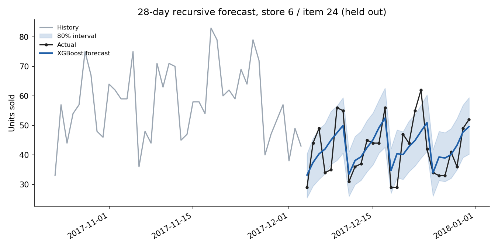
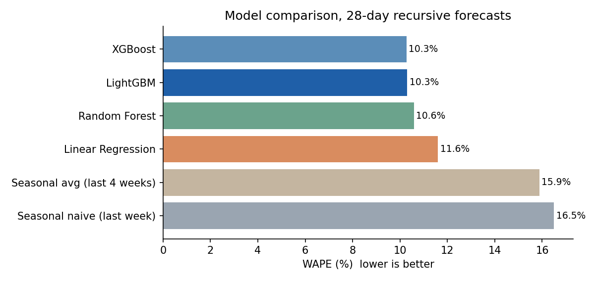
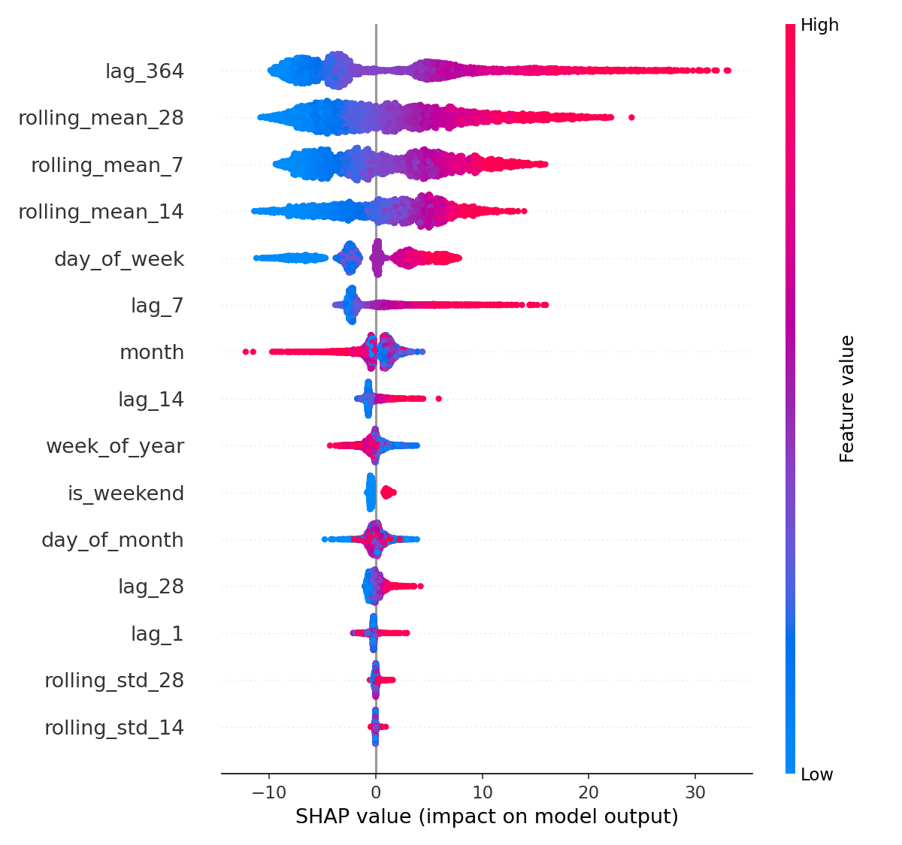

# 📈 Retail Demand Forecasting

28-day demand forecasts for 500 store-item series (10 stores × 50 items, 913k daily rows of real retail sales), with **prediction intervals**, a **rolling-origin backtest**, and a Streamlit app that computes every feature from history itself.



## Headline results

Scored on a 6-fold rolling-origin backtest. For every fold, each model is retrained on data **before** the forecast origin only, then forecasts the next 28 days **recursively**, never seeing an actual after the origin.

| Model | MAE | WAPE | vs seasonal naive (MAE) |
|---|---|---|---|
| **XGBoost (tuned)** | **6.18** | **10.3%** | **-38%** |
| LightGBM (tuned) | 6.20 | 10.3% | -38% |
| Random Forest | 6.36 | 10.6% | -36% |
| Linear Regression | 6.97 | 11.6% | -30% |
| Seasonal avg (last 4 weeks) | 9.55 | 15.9% | -4% |
| Seasonal naive (last week) | 9.92 | 16.5% | baseline |

- **Prediction intervals are honest.** Calibrated on older folds and checked on the newest fold they never saw: nominal 80% → **79.4%** actual coverage, 90% → **89.9%**, 50% → **49.5%**.
- **Error does not grow with horizon**: WAPE is 10.6% on day 1 and 10.6% on day 28. Noise dominates this data, not error compounding (see *Limitations*).
- XGBoost and LightGBM are statistically indistinguishable; XGBoost is kept because it scored marginally better.



## What the model learned (SHAP)

Last year's same-day sales (`lag_364`) is the strongest driver, followed by recent averages and day of week. This is the shape of yearly seasonality plus a weekly cycle plus the current level.



## How it works

1. **Features** (`demand/features.py`): lags (1, 7, 14, 28, 364 days), rolling mean/std (7/14/28, shifted so a day never sees itself), calendar, store and item. One function builds the features for any day from the history before it, and is used for both training and forecasting, so there is no train/serve skew.
2. **Recursive multi-step forecasting** (`demand/forecast.py`): a one-step model is rolled forward 28 days, feeding each prediction back in as the next day's lag. The app does the same on live history, so users pick a store, item and horizon and type no statistics.
3. **Tuning** (`tune.py`): randomized search with a **time-ordered** `TimeSeriesSplit` and a 28-day gap, using only data before the first backtest origin.
4. **Backtest** (`backtest.py`): 6 origins spaced 55 days apart. The spacing is deliberately not a multiple of 7, so folds start on different weekdays; with an 8-week spacing, "days ahead" is silently confounded with day of week.
5. **Prediction intervals** (`demand/intervals.py`): empirical quantiles of backtest errors per horizon step, standardised by √forecast. No distributional assumption.
6. **App** (`app.py`): forecast with interval band, a per-day stock target at a chosen service level, store totals, backtest evidence, and SHAP.

## Run it

```bash
pip install -r requirements-dev.txt

# Data: download train.csv from the Kaggle "Store Item Demand Forecasting Challenge"
# (https://www.kaggle.com/competitions/demand-forecasting-kernels-only/data)
# and save it as data/real_sales_data.csv  (columns: date, store, item, sales)

python tune.py        # ~25 min: hyper-parameter search
python backtest.py    # ~7 min: rolling-origin backtest, intervals, charts
python train.py       # final fit on all data, SHAP, exports for the app
streamlit run app.py  # launch the app (run from the repo root)
pytest -q             # tests
```

(A `Makefile` with the same targets is included if you have `make`.)

The app needs only the committed `models/demand_model.pkl`, `app_data/history.csv.gz` (the last 400 days) and `reports/`, so it runs without the raw data.

**Deploy:** push to GitHub, then on [Streamlit Community Cloud](https://streamlit.io/cloud) create an app from the repo with `app.py` as the entry point. `requirements.txt` is the lean runtime set.

## Tests

`tests/test_demand.py` covers the bugs that silently ruin forecasting projects: features ignore the current and future rows, training features equal serving features, recursive forecasts never read the future, seasonal baselines use the right weekday, and interval coverage matches its nominal level.

## Limitations

- **No promotions, prices, holidays or stock-outs** in this dataset; none are modelled, and sales are treated as demand.
- **Smooth data.** Error is mostly irreducible noise, which is why error is flat across horizons and why tuned boosting beats a good seasonal baseline by "only" 38%. Spikier data (e.g. M5) would be a harder test.
- **Single backtest period** (the last ~10 months of 2017). The newest fold (December) is the hardest for every model.
- **Intervals are marginal**, calibrated on 6 folds; they would need recalibrating after a regime change. Intervals for store totals are not provided, since they need cross-item error correlation.
- **Linear Regression bias**: it over-forecasts by ~2%; tree models are near 0%.

## Project structure

```
demand/        features, models, recursive forecast, metrics, intervals
tune.py        time-ordered hyper-parameter search
backtest.py    rolling-origin backtest, interval calibration, charts
train.py       final fit, SHAP, app exports
app.py         Streamlit app
tests/         pytest suite (leakage and serving-consistency checks)
models/        production model (small, committed)
app_data/      last 400 days of history for the app
reports/       metrics CSVs, charts, calibration
```

Data: Kaggle Store Item Demand Forecasting Challenge. Not redistributed here beyond the 400-day slice the app needs.
